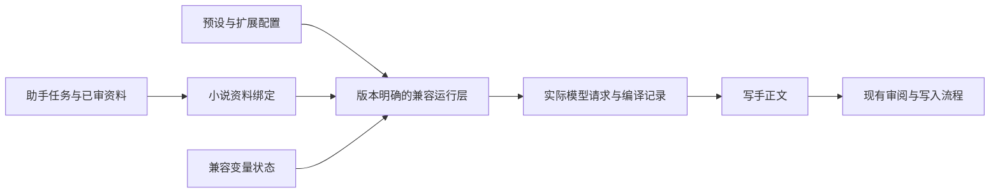

# 写手酒馆预设兼容与编排工作区

状态：draft（长期工作区与状态方案仍待决定）。2026-10-11，开发者提供图灵预设并明确要求开始样本开发；本地兼容运行与对照已授权，目标合同见 [写手兼容 Spec](../specs/writing/tavern-preset-compatibility.md)。这不表示完整编辑工作区或所有长期取舍均已批准。

## 问题

开发者希望改善写作写手的产出，并明确要求：仅针对写手兼容酒馆预设，使最终提示词结构与酒馆一致。目前需要解决三个核心问题：预设初始化自定义变量并用于注入；资料主要由助手提供，但 user/char 宏对象难以界定；提示词的生效机制需要与酒馆一致。

现有条目排序、角色、字符串替换和快照提供了基础，但不能完整表达酒馆的占位项、宏副作用、条件、深度注入、预算及扩展处理。SPreset Editor 提供了适合参考的编辑模型，同时也证明编辑器与实际执行环境必须分别验证。

## 目标与非目标

### 开发者已明确的目标

- 仅作用于写作模块的写手，覆盖场景正文和局部改写。
- 导入并使用酒馆预设，最终提示词结构与酒馆一致。
- 正确处理预设自定义变量初始化、宏身份和提示词生效规则。
- 参考 SPreset Editor 的能力整理可实施方案。

### 建议的范围边界

保留主创、资料助手、独立审核助手的现有职责，写手仍只按审核后的任务写正文；兼容层不接管剧情规划、资料审批或正文写入。写手每次使用全新模型上下文，兼容变量状态另行管理。

先针对 Chat Completion 原生预设；Text Completion 的 instruct/context 模板属于另一条链路。扩展按目标预设实际依赖实现，并列明版本和支持范围。目标预设依赖尚未支持的扩展时，不将其标记为可等价执行。

本轮方案不包含完整酒馆浏览器环境、任意第三方插件宿主或写手工具权限扩张。结构兼容也不承诺每次生成文本完全相同；文学质量另行评测。

## 当前行为与证据

从当前代码可确认：写手用途已有独立预设条目、启用状态、三种角色、动态变量及每次尝试的快照；OpenAI 兼容请求可以保留有序消息。当前变量替换是一次性字符串展开，条目数据无法表达全部酒馆语义。其他 API 对多条或交错 system 有限制。审阅投影重新渲染模板，在引入副作用后需要改变。

证据及固定上游版本集中见 [写手兼容研究](../../packages/neuro-book/docs/research/sillytavern-writer-preset-compatibility.md) 与 [SPreset 分析](../../packages/neuro-book/docs/research/spreset-editor.md)。当前产品依据仍是 [写作协作 Spec](../specs/writing/collaboration.md) 和 [提示词管理 Spec](../specs/ui/prompt-management.md)，两者当前标记 planned，已有实现不等于正式验收完成。

SPreset 的公开 Git 注入脚本与动态在线编辑器存在版本差异。嵌套宏、消息合并和预设正则有固定源码证据；新版条件脚本、工具绑定等目前只有在线配置与接口调用证据。实施前须取得匹配运行版本。

## 方案、备选方案和取舍

### 整体结构：管理、绑定、兼容运行三层

| 层 | 职责 | 主要结果 |
| --- | --- | --- |
| 预设管理 | 导入、编辑、复用、选择、版本与依赖检查 | 原生预设及已保存的增强配置 |
| 小说资料绑定 | 将审核后的任务、人物、文风和正文映射到酒馆输入 | 固定身份、场景、示例、历史与资料快照 |
| 兼容运行 | 按指定酒馆/扩展版本解释宏、状态、位置、生效、裁剪与 API 转换 | 实际发送内容、变量变化及解释记录 |

图表达职责与数据流，不规定所有插件都使用同一执行顺序；具体求值和 hook 时序由对应版本定义。

### 预设管理：借鉴 SPreset 工作区

建议沿用现有全局提示词管理入口，给写手增加专用编辑工作区，不将其他 Agent 的编辑方式一并改造。

- 左侧资源库：未使用片段、收藏模板和文件夹，支持搜索与复用。
- 中间提示词链：顺序条目与深度注入条目分开显示；编辑启用状态、角色和位置。
- 右侧条目详情：正文、Depth、Order、生成触发器、覆盖规则，以及已支持的条件/扩展配置。
- 提供草稿、撤销/重做、保存及原生预设导入导出。编辑器工作区文件与原生酒馆预设文件分别识别。
- 提供编译结果查看：实际身份与变量、条目生效依据、插入/裁剪及最终请求。来源文本中保留到预设条目和资料的定位。

保留 prompts、prompt_order、identifier、marker、扩展元数据和未知字段，不将原文件不可逆地转换成平面 entries。影响运行的未知字段或缺失依赖须明确说明；保存原文件与可以执行是不同状态。内置预设只读保护继续适用。

现有写手条目开关即时保存应保留到新方案中；条件脚本覆盖的是本次生成的启用结果，不能悄悄改写用户保存的开关。新工作区的其他草稿恢复与离开语义会改变现有编辑体验，需在批准后纳入 UI Spec。

### 身份绑定：区分来源、Persona 和消息角色

建议默认绑定如下，但仍需开发者确认：

| 对象 | 建议默认含义 |
| --- | --- |
| 资料助手 | 写作任务和参考资料的生产者，记录来源 |
| `{{user}}` | 创作委托方的名字，默认“创作委托方” |
| `{{persona}}` | 创作委托方的描述，说明由助手整理并提交写作要求 |
| `{{char}}` | 写手身份的名字，默认“小说叙述者” |
| 角色卡描述 | 写手负责多角色小说叙事的职责与边界 |
| system/user/assistant | 由预设编排决定的 API 消息角色 |
| 小说人物 | 保留在场景和资料中，不自动替换为 user/char |

助手生成的任务可以进入 user 消息，表示写手收到的委托；无需将助手的完整对话伪装成写手历史。宏值不随所在消息角色或资料助手模型改变，名字与描述分别保存。

如果预设要求 user 为玩家人物、char 为单个扮演角色，需要显式绑定或说明不适用。将宏换成默认名字只能完成词法展开，不能保证 RP 行为与小说叙事一致。

### 小说资料到运行输入的绑定

助手继续提供任务与经过审核的资料；适配层决定它们进入预设哪个槽位，不能在预设编排完成后偷偷追加旧写手模板。

| 写作内容 | 建议的酒馆输入位置 | 待细化事项 |
| --- | --- | --- |
| 当前场景、细纲、落点和要求 | scenario 或明确的当前任务输入 | 如何完整承载必需事实，由绑定方案规定 |
| 人物及场景相关资料 | 角色/场景资料或世界书输入 | 已审核资料的绑定与原生世界书激活分别声明 |
| 文风样文 | dialogueExamples 或预设明确的样文片段 | 普通样文转酒馆示例的编码规则 |
| 已通过正文 | 构造虚拟 chatHistory | 分段粒度、消息角色与深度起点尚待决定 |
| 局部改写目标与上下文 | 改写用途的当前任务与上下文槽位 | 不将待替换旧文误作已生成的新输出 |
| 审阅退回问题 | 本次重写任务输入 | 与新尝试身份、变量状态关联 |

原有事实覆盖保护改为检查实际绑定与编译结果。缺失必需资料时停止并定位原因，避免为了通过原变量名校验而伪造正文。伏笔定义等原本未授权给写手的资料仍不可被第三方模板读取。

### 自定义变量：兼容状态独立于模型上下文

需要分别支持 ST 本体宏变量、Tavern-Helper 预设/聊天等作用域变量，以及 EJS 初始变量与读取规则。缺值、默认合并、覆盖、嵌套和新旧宏引擎顺序按所选版本执行，不自行统一语义。

建议为写作运行定义兼容状态身份，并让每次尝试固定其输入状态。global/preset/chat/message 等作用域的具体归属另列待决策，不能把所有变量简单归到一个新会话或一个全局表。

对于本体等即时写入的求值路径，不能统一延迟到模型成功或正文通过才保存，也不能认为模型失败会自动撤销已发生的变量变化。新尝试可以重新求值；同一尝试的审阅、展示和恢复读取已保存结果，不再次运行宏。

编译记录至少包含预设/引擎/扩展版本、身份和资料、变量前后状态或可恢复变化、生成模式、实际消息、最终 API 请求与生效解释。多处读取同一尝试共用该记录。

交互式预览建议在隔离状态副本中求值并展示预期变化，不污染真实状态；这是预览产品策略，不可声称与酒馆所有 dry run 副作用相同。真实兼容对照则使用独立但相同的初始状态，检查实际副作用。

### 提示词生效：以对应版本执行为准

应覆盖活跃 prompt_order 的选择、enabled、生成 trigger、角色覆盖、marker 展开、宏求值、条件/过滤、深度插入、示例及历史预算、正则、消息合并和 API 转换。

分别记录条目是否启用、是否求值、是否进入最终请求；裁剪前已经求值的片段可能留下变量副作用。UI 顺序、求值顺序和最终消息位置不能混为一谈。

扩展兼容分项登记：

| 能力 | 建议处理 |
| --- | --- |
| 原生 Prompt Manager 与宏 | 基础兼容能力，固定宏引擎及生成模式 |
| ST-Prompt-Template | 目标预设依赖 EJS 时支持相应版本函数、初值和注入阶段 |
| Tavern-Helper | 按依赖支持变量与生成/注入语义，不默认运行任意脚本 |
| SPreset MacroNest/ChatSquash/RegexBinding | 开启时必须纳入对照，不能仅保存配置 |
| SPreset 条件脚本 | 获取匹配注入层后核实运行行为，再确定支持合同 |
| 工具绑定与结构化工具历史 | 不自动扩张写手权限；预设依赖时单独决定支持范围 |

不能承诺以上插件组合已经具有完整已验证执行顺序。未知依赖阻止该预设的等价执行，明确报告具体字段/功能。

### API 与采样

建议先用同一 OpenAI Chat Completion 兼容 API 验证，保留 role、content、name 和消息边界，再扩展其他 API。Claude/Gemini 的原生转换单独对照；assistant 示例与真正 prefill 分别处理。

采样、输出额度、停止字符串及推理设置属于请求等价的一部分。新酒馆路径需定义预设参数与作品角色设置、Provider 默认的优先级；当前尚未决定。不能保存未知参数后静默忽略，或把不同实际参数下的产出差异归因于编排。

### 备选方案

| 方案 | 取舍 |
| --- | --- |
| 转为现有平面条目 | 实现较小，但丢失深度、占位、覆盖、变量及扩展语义，不能达到既定兼容目标 |
| 版本明确的兼容运行层 | 推荐；可按依赖实现并通过对照验证，需要维护版本与差异样本 |
| 内嵌完整酒馆 | 可借用现成行为，但带入浏览器、聊天和插件依赖；适合作为对照端，是否成为产品依赖需另行评估 |

## 数据、接口、安全、迁移、发布与回滚影响

- **数据归属**：建议预设与模板继续由 App State 管理，作品资料由写作流程提供；身份选择、运行状态和各变量作用域的持久化 owner 需明确后再实施。跨作品 global/preset 状态不能未经决定就共享。
- **格式与接口**：新增酒馆预设格式识别、依赖报告、身份/槽位绑定、编译结果与变量状态版本。保留普通预设路径与历史快照，不用新语义解释旧会话。
- **执行边界**：EJS 和条件脚本需要受控执行上下文与资源限制，不能继承应用文件、网络与凭据访问权限。受限实现缺少功能时明确列出兼容缺口。
- **一致性与恢复**：变量副作用和模型请求之间存在中断窗口；保存已求值记录与请求身份，不能用重新求值假装恢复。并发作用域写入、冲突处理与不确定是否发送的恢复策略需纳入合同，不宣称全局事务或网络恰好一次。
- **迁移**：保留已有预设、内置保护、正文、运行和快照。用户显式选择兼容预设后才影响新写手尝试；进行中的尝试与后续审阅保持同次版本。
- **发布与回滚**：本轮已授权本地样本开发，尚无发布授权。未来发布需标注实际支持的版本/API/扩展；回到普通预设后保留历史兼容记录，不能通过删除变量状态或历史快照来回滚。

## 对 Spec 的预期改动

批准后，更新 `writing.collaboration` 中写手输入绑定、尝试快照、变量状态、审阅及恢复边界；更新 `ui.prompt-management` 中写手专用预设格式、工作区、导入/导出、开关与条件的关系、草稿恢复和错误反馈。

可独立验收的兼容运行能力建议登记单独 capability，定义输入版本、依赖、编译输出、状态变化、失败与恢复，不把第三方源码实现细节复制为所有 Agent 的通用规则。采样优先级与脚本执行边界也必须写入正式合同。

### 分阶段验证与交付依据

1. **确定样本与绑定**：目标预设、配套资产、酒馆与扩展版本、宏引擎、API、初始状态及小说绑定规则。
2. **验证基础编排**：相同槽位输入比较原生预设顺序、占位展开、role/name/content、覆盖、深度与预算。以无扩展样本建立基线。
3. **验证动态能力**：加入变量初始化、嵌套、条件、EJS、注入、SPreset 合并/正则；比较副作用及扩展处理结果。目标依赖未完成时仍不声明该预设兼容。
4. **接入写作与编辑工作区**：验证真实入口、场景和改写、资料覆盖、开关、每次尝试版本及审阅恢复；编辑 UI 按批准后的合同验收。
5. **验证最终请求与产出**：同 API 比较原生请求，覆盖失败/取消/重试及状态延续；再以相同模型和参数进行真实写作评测。

结构等价证据包括最终请求和变量前后状态。模型输出用于质量评测，不能替代编排对照。本地样本实现已登记 [Task](../../.agents/works/w00023-writer-tavern-compatibility/tasks/t01-preset-runtime/README.md)，cabo Opus 4.6 的两路同输入真实调用已通过正文格式与正则样本检查；完整产品参数及输出管线仍待接入。

### 本轮接入决定与剩余证据

| 项目 | 当前建议或缺口 |
| --- | --- |
| 首批兼容对象 | 需要实际目标预设、完整配套资产与匹配运行版本，不能只以插件名称划范围 |
| 宏身份 | 本轮默认 user=作者、char=写手，并允许显式绑定；不从资料助手或小说角色推断 |
| 槽位与历史 | 作品变量默认映射启用资料槽位，已通过正文作为 assistant、任务作为 user；可显式编辑绑定 |
| 变量作用域 | 本轮 local 按写作会话、global 按项目/用途/预设隔离，另有单次尝试选项；更完整插件作用域不在本轮兼容范围 |
| 参数优先级 | 本轮显式覆盖 > 预设 > Profile/Provider 默认，模型/服务商仍由作品设置；见 Spec 的实际请求边界 |
| 扩展脚本 | 支持哪些 API、执行边界与缺失依赖的处理需由目标样本收敛 |
| 编辑与执行版本 | SPreset 在线 UI 的新增能力需要匹配注入层证据；宏/插件组合仍缺运行对照 |

## 决策记录

- 2026-10-11，开发者：希望研究类似酒馆的提示词编排与产出，范围仅限写作模块写手。
- 2026-10-11，开发者：明确目标为写手兼容酒馆预设，最终提示词结构与酒馆一致；指出变量初始化、user 宏身份和生效机制三个问题。
- 2026-10-11，开发者：要求分析 SPreset Editor，随后整理当前方案。
- 2026-10-11，整理建议：采用管理、小说绑定、兼容运行三层，参考 SPreset 编辑模型，以同输入/版本/API 的请求与变量状态对照验收；长期未决项保留。
- 2026-10-11，开发者：提供图灵预设，明确要求开始开发，以酒馆兼容和效果对照为目的，条目性质不影响任务范围。
- 2026-10-11，开发者：提供清洗后的请求日志，再补充带对象头的日志作为参考。样本体现 strict 后处理、继续生成与 claude-opus-4-6；接口地址、实际版本和插件设置尚未证明。
- 2026-10-11，开发者：授权继续开发与完善剩余部分，全部完成后统一验收。本轮接入专用编辑器、作品默认绑定、参数采用与覆盖、会话/项目隔离的变量延续、输出处理及样本本地质检；可配置默认与准确兼容边界记录在 planned Spec，未取得完整通用插件或发布承诺。
- 2026-10-11，开发者：进一步明确无需同步兼容酒馆插件，仅兼容预设提示词，要求补齐并接入项目配置中心。本轮采用两种原生宏引擎、完整文本后处理、显式词表预算、原生注入触发、历史名称及正则查找宏替换；SPresetSettings/条件脚本只保留并登记依赖，普通条目按原生开关生效，不执行插件条件。当前合同和验收边界见 Spec；源码位于本地开发 worktree，未发布或合并。

原 [统一提示词管理提案](./unified-prompt-management.md) 中“不兼容酒馆宏”的决定属于当时实现范围。本提案承接新的写手兼容需求，不据此追改旧决策，也不把新范围推广到其他 Agent。
