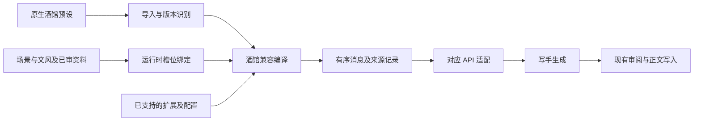

# 写手兼容 SillyTavern 预设与提示词结构研究

日期：2026-10-11。状态：源码研究与方案建议，尚未实施，不是当前产品合同。

## 研究目标与结论

开发者明确的目标是：**仅针对写作模块的写手，兼容酒馆预设，并使最终提示词结构与酒馆保持一致。** 因此验收必须比较预设的解释结果和实际模型请求；文学质量评测是后续证据，不能代替结构一致性验证。

建议增加**按上游版本定义行为的写手专用酒馆兼容编译器**，复用现有写手会话、工作流、审阅与运行记录。它需要解释原生预设、绑定运行时资料、展开占位项和宏、执行已支持的扩展处理，再经对应 API 适配器发送。把酒馆 JSON 转成当前的平面条目列表，或者只增加 EJS 求值，都不足以达到这个目标。

“与酒馆一致”需要限定对照条件：相同预设、相同已绑定资料与历史、相同上游版本和扩展版本/配置、相同生成模式与预算、相同 API 和模型能力。相同预设绑定不同章节资料，当然不会得到逐字相同的提示。推荐先以同一组输入验证编译等价，再验证小说数据的绑定是否合理。

## 来源与验证边界

本次外部结论来自一手源码、类型声明和项目自身文档，固定如下版本。版本号只标识本次阅读对象，不代表已验证所有版本兼容。

| 项目 | 阅读版本 | 所有权 |
| --- | --- | --- |
| [SillyTavern](https://github.com/SillyTavern/SillyTavern/tree/06bde939fb1e9c4c8d8641d810f0a916b5bce127) | release，`06bde939fb1e9c4c8d8641d810f0a916b5bce127`，package 1.19.0 | Prompt Manager、World Info、示例/历史、预算、API 转换与采样 |
| [JS-Slash-Runner / Tavern-Helper](https://github.com/n0vi028/JS-Slash-Runner/tree/c0196caee03955aa39e00db1a2623b2591bd3c6f) | main，`c0196caee03955aa39e00db1a2623b2591bd3c6f`，manifest 4.11.3 | JavaScript 脚本运行与酒馆功能 API |
| [ST-Prompt-Template](https://github.com/zonde306/ST-Prompt-Template/tree/d6f520d149aba146305b0b781ddd691d449c28d2) | main，`d6f520d149aba146305b0b781ddd691d449c28d2`，manifest 1.17.9 | EJS、条件规则、动态注入、生成和显示阶段模板 |

未安装运行酒馆，未执行扩展脚本，未调用真实模型，也未取得开发者的目标预设及完整配套资产。项目现状来自当前工作区代码阅读；没有把现有测试文件的存在写成本次测试通过。本文不能证明已达成请求等价或文学产出等价。

既有 [RP 工具研究](./st-roleplay-tooling.md) 引用了历史本地参考目录；这些目录本次不可用。本文使用固定提交的在线源，且讨论的是写作写手，不沿用该文的 RP 迁移目标。

## 酒馆各层实际负责什么

### 预设与消息编排属于 SillyTavern 本体

Chat Completion 预设需要同时解释条目定义、排列/启用状态和运行时占位项。`prompts` 不是最终发送数组；`prompt_order` 不是单纯 UI 展示顺序。角色描述、性格、场景、世界书、示例、聊天历史等项需要运行时资料才能展开。[默认预设源码](https://github.com/SillyTavern/SillyTavern/blob/06bde939fb1e9c4c8d8641d810f0a916b5bce127/default/content/presets/openai/Default.json)。

编排还涉及以下事实：

- 普通预设项可指定角色和插入位置/深度/次序；某些主提示及末尾指令可受角色卡覆盖。因此只排序文本会丢失覆盖和插入语义。[配置应用](https://github.com/SillyTavern/SillyTavern/blob/06bde939fb1e9c4c8d8641d810f0a916b5bce127/public/scripts/openai.js#L1469)。
- 示例不是普通正文段。该版本解析 `<START>` 示例块，并在组装时使用带 `name` 的 system 消息，再经 Provider 转换；不能笼统认为酒馆的样例始终是 user/assistant 两条消息。[示例解析](https://github.com/SillyTavern/SillyTavern/blob/06bde939fb1e9c4c8d8641d810f0a916b5bce127/public/scripts/openai.js#L656)、[示例组装](https://github.com/SillyTavern/SillyTavern/blob/06bde939fb1e9c4c8d8641d810f0a916b5bce127/public/scripts/openai.js#L1101)。
- `pin_examples` 改变示例与历史的预算分配优先级；输入预算还要扣除输出预算。[分配顺序](https://github.com/SillyTavern/SillyTavern/blob/06bde939fb1e9c4c8d8641d810f0a916b5bce127/public/scripts/openai.js#L1336)、[预算计算](https://github.com/SillyTavern/SillyTavern/blob/06bde939fb1e9c4c8d8641d810f0a916b5bce127/public/scripts/openai.js#L1567)。
- 默认预设中的 Post-History Instructions 使用内部 identifier `jailbreak`。它是历史后的指令位置；迁移时应保留其真实标识和编排语义，不因名字删除或替换该项。[默认预设](https://github.com/SillyTavern/SillyTavern/blob/06bde939fb1e9c4c8d8641d810f0a916b5bce127/default/content/presets/openai/Default.json)。

### 原生预设的关键解析合同

| 字段或行为 | 固定版本中的含义 | 导入要求 |
| --- | --- | --- |
| `prompts[].identifier` | 条目与运行时槽位的关联标识 | 保留原标识，不用显示名称替代 |
| `prompt_order[].character_id` | 指定策略下的顺序集合身份 | 结合 Prompt Manager 策略选活跃集合，不能固定取数组第一项 |
| `order[].identifier/enabled` | 实际采用顺序和启用状态 | 按 order 查定义；不直接采用全部 prompts |
| `marker: true` | 历史、示例、世界书等运行时展开位置 | 允许没有 content/role，不能补成空文本消息 |
| `role` 与 `system_prompt` | role 是消息角色；后者是条目分类标志 | 不得因 system_prompt 为 true 就覆盖 role |
| `injection_position/depth/order` | 相对位置或聊天深度注入及排序 | 保留分流和合并规则，不能转成普通数组索引 |
| `injection_trigger` | normal/continue/quiet 等生成模式筛选 | 固定生成模式后判断是否采用 |
| `forbid_overrides` | 是否允许角色卡覆盖 main/PHI | 同时保留预设原文和覆盖条件 |
| 宏与 `{{original}}` | 参数替换及覆盖时引用原提示 | 按上游语义求值，不能套用当前 NeuroBook 变量替换规则 |

默认文件有 `100000`、`100001` 两份顺序集合；本次版本 Chat Completion 配置为 `strategy: 'global'`、`dummyId: 100001`。这些 ID 不能当作小说人物身份。[策略配置](https://github.com/SillyTavern/SillyTavern/blob/06bde939fb1e9c4c8d8641d810f0a916b5bce127/public/scripts/openai.js#L696)、[集合查找](https://github.com/SillyTavern/SillyTavern/blob/06bde939fb1e9c4c8d8641d810f0a916b5bce127/public/scripts/PromptManager.js#L1207)。

Prompt Manager 按活跃 order 的顺序查定义，并结合 enabled 与 trigger 筛选；停用的 main 仍保留空内容内部锚点。因此“停用条目不发送”与“内部完全删掉条目”也不能视为同一算法。[顺序及筛选](https://github.com/SillyTavern/SillyTavern/blob/06bde939fb1e9c4c8d8641d810f0a916b5bce127/public/scripts/PromptManager.js#L1516)、[宏准备](https://github.com/SillyTavern/SillyTavern/blob/06bde939fb1e9c4c8d8641d810f0a916b5bce127/public/scripts/PromptManager.js#L1277)。

此版本 `RELATIVE=0`、`ABSOLUTE=1`，默认 depth 为 4、order 为 100。名称 ABSOLUTE 指聊天深度注入，不是整个 payload 的第 N 项。深度处理会按 injection_order 降序分组，再按 system/user/assistant 收集；同深度、order 和 role 的文本以换行合并，order=100 还与扩展提示关联，内部历史插入后再反转。这说明消息边界也由算法生成，不一定等于一个预设条目一条消息。[常量与字段](https://github.com/SillyTavern/SillyTavern/blob/06bde939fb1e9c4c8d8641d810f0a916b5bce127/public/scripts/PromptManager.js#L31)、[深度注入](https://github.com/SillyTavern/SillyTavern/blob/06bde939fb1e9c4c8d8641d810f0a916b5bce127/public/scripts/openai.js#L810)、[相对与深度分流](https://github.com/SillyTavern/SillyTavern/blob/06bde939fb1e9c4c8d8641d810f0a916b5bce127/public/scripts/openai.js#L1242)。

示例解析生成的消息 name 是 `example_user` / `example_assistant`；它与 `prompts[].name` 的界面标题不同。[解析器](https://github.com/SillyTavern/SillyTavern/blob/06bde939fb1e9c4c8d8641d810f0a916b5bce127/public/scripts/openai.js#L729)。标准预设不自动包含全部运行时资料，但预设可能携带 `extensions`，酒馆助手也支持预设作用域资产；需要识别实际附带内容，不能一概丢弃扩展字段。[扩展读取](https://github.com/SillyTavern/SillyTavern/blob/06bde939fb1e9c4c8d8641d810f0a916b5bce127/public/scripts/openai.js#L5053)。

### JS-Slash-Runner 是控制这些能力的脚本宿主

用户提供的项目是酒馆助手。其生成 API 中，`generate()` 使用当前或指定预设，并允许 overrides、injects、历史限制；`generateRaw()` 通过 `ordered_prompts` 显式组织占位项和消息，未列出的占位项不采用。后者绕过提示词预设，仍使用酒馆生成参数和模型请求路径，不是完全独立的 LLM 客户端。[API 类型](https://github.com/n0vi028/JS-Slash-Runner/blob/c0196caee03955aa39e00db1a2623b2591bd3c6f/%40types/function/generate.d.ts)、[生成实现](https://github.com/n0vi028/JS-Slash-Runner/blob/c0196caee03955aa39e00db1a2623b2591bd3c6f/src/function/generate/responseGenerator.ts)。

兼容一个依赖这些 API 的脚本，与兼容一份不含脚本的原生预设，是不同工作量。脚本可能在生成前改世界书、变量或注入内容；预设 JSON 自身不足以复现这些输入。

### EJS Prompt Template 是另一扩展

ST-Prompt-Template 在发送前求值模板，支持条件、变量操作和消息注入。`@INJECT` 可以按位置、目标或正则定位插入完整消息；处理还涉及宏、正则、EJS 的先后顺序。[扩展说明](https://github.com/zonde306/ST-Prompt-Template/blob/d6f520d149aba146305b0b781ddd691d449c28d2/README_CN.md)、[功能文档](https://github.com/zonde306/ST-Prompt-Template/blob/d6f520d149aba146305b0b781ddd691d449c28d2/docs/features_cn.md#L219)、[注入实现](https://github.com/zonde306/ST-Prompt-Template/blob/d6f520d149aba146305b0b781ddd691d449c28d2/src/features/inject-prompt.ts)。

`[GENERATE:*]` 和 `[RENDER:*]` 的作用不同：前者影响模型提示，后者只影响显示。显示阶段生成的状态栏不代表模型看过相同内容。[阶段说明](https://github.com/zonde306/ST-Prompt-Template/blob/d6f520d149aba146305b0b781ddd691d449c28d2/docs/features_cn.md#L70)。

如果目标预设含 EJS，导入成功但未求值，便不能称为编排兼容。若模板依赖变量、世界书或扩展函数，还必须提供对应上下文与函数语义。用另一个条件 DSL 重写模板可以得到相近能力，却不等于兼容原模板。

### 世界书、正则与输出参数会改变结果

World Info 会进行激活、概率、预算、递归扫描和位置归档；并非整本世界书无条件拼入提示。[位置](https://github.com/SillyTavern/SillyTavern/blob/06bde939fb1e9c4c8d8641d810f0a916b5bce127/public/scripts/world-info.js#L855)、[预算](https://github.com/SillyTavern/SillyTavern/blob/06bde939fb1e9c4c8d8641d810f0a916b5bce127/public/scripts/world-info.js#L4736)、[激活与裁剪](https://github.com/SillyTavern/SillyTavern/blob/06bde939fb1e9c4c8d8641d810f0a916b5bce127/public/scripts/world-info.js#L5014)。

正则区分 Markdown 显示和 prompt 处理。最终请求对照要包含 prompt 正则；产出评测则应分别保留模型原文、后处理结果和显示结果。[正则引擎](https://github.com/SillyTavern/SillyTavern/blob/06bde939fb1e9c4c8d8641d810f0a916b5bce127/public/scripts/extensions/regex/engine.js#L334)。

酒馆请求还包含 temperature、top_p、频率/存在惩罚等设置，服务端按 Provider 和模型处理。不支持的参数不能因为存在于预设就保证生效。[请求构造](https://github.com/SillyTavern/SillyTavern/blob/06bde939fb1e9c4c8d8641d810f0a916b5bce127/public/scripts/openai.js#L2803)、[模型限制](https://github.com/SillyTavern/SillyTavern/blob/06bde939fb1e9c4c8d8641d810f0a916b5bce127/src/endpoints/backends/chat-completions.js#L257)。

## 必须区分的两种一致性

### Chat Completion 与 Text Completion

SillyTavern 的 `main_api === 'openai'` 是 Chat Completion 大类，不表示仅使用 OpenAI 品牌模型。该链路发送结构化消息；Text Completion 链路发送 `finalPrompt` 字符串，并可能使用 instruct/context template 的输入输出序列。[生成分流](https://github.com/SillyTavern/SillyTavern/blob/06bde939fb1e9c4c8d8641d810f0a916b5bce127/public/script.js#L4307)、[请求分流](https://github.com/SillyTavern/SillyTavern/blob/06bde939fb1e9c4c8d8641d810f0a916b5bce127/public/script.js#L5273)、[Instruct 格式化](https://github.com/SillyTavern/SillyTavern/blob/06bde939fb1e9c4c8d8641d810f0a916b5bce127/public/scripts/instruct-mode.js#L387)。

建议第一条实现链路针对 Chat Completion 预设。Text Completion 需要单独登记能力，不能默认把 ChatML 等特殊序列塞入当前 Chat API 正文。

### 编排结果与 Provider 最终请求

相同 role 消息经过不同 API 后未必保留相同结构。例如该版本 Claude 转换器提取前部 system，转换后续 system，并合并连续同角色消息。[Claude 转换](https://github.com/SillyTavern/SillyTavern/blob/06bde939fb1e9c4c8d8641d810f0a916b5bce127/src/prompt-converters.js#L197)。

assistant 示例也不等于 assistant prefill。酒馆有特定的 prefill/续写分支，部分模型会把末尾 assistant 改成 user。[客户端分支](https://github.com/SillyTavern/SillyTavern/blob/06bde939fb1e9c4c8d8641d810f0a916b5bce127/public/scripts/openai.js#L2872)、[prefill 添加](https://github.com/SillyTavern/SillyTavern/blob/06bde939fb1e9c4c8d8641d810f0a916b5bce127/src/prompt-converters.js#L335)、[模型降级](https://github.com/SillyTavern/SillyTavern/blob/06bde939fb1e9c4c8d8641d810f0a916b5bce127/src/endpoints/backends/chat-completions.js#L393)。

因此应同时比较两个阶段：酒馆编排出的消息序列，以及同一 API 下最终发送的原生 payload。只比较提示词预览界面不够。

## NeuroBook 当前差距

以下为从当前代码推断。写作与全局提示词管理的 Spec 当前均标记 `planned`；代码已有接入不代表正式验收完成。[写作 Spec](../../../../docs/specs/writing/collaboration.md)、[提示词管理 Spec](../../../../docs/specs/ui/prompt-management.md)。

| 边界 | 已有能力 | 酒馆兼容差距 |
| --- | --- | --- |
| 预设数据 | 条目 ID、显示名称、role、content、enabled、数组顺序 | 缺原生预设导入、marker、独立 order、深度/位置、覆盖与生成模式字段 |
| 模板求值 | 单次 `{{变量}}` 字符串替换 | 缺酒馆宏语义、EJS、扩展函数/状态与处理顺序 |
| 示例 | 可编辑 assistant/user 条目，样文默认 system 文本 | 没有酒馆示例块解析、消息 `name` 和示例预算行为 |
| 连续性 | 每次写手新会话，以变量提供已通过正文 | 小说正文不自动等于酒馆历史，需要明确虚拟历史绑定 |
| 模型请求 | 新快照保留有序消息，OpenAI 兼容 API 在原生 payload 注入 | 当前消息类型只保留 role/content；其他 API 拒绝多条或交错 system |
| 模型参数 | 写作角色配置 modelKey、reasoningEffort、temperature | 当前公开 requestOptions 不接受 top_p/top_k/惩罚等任意字段，不能原样移植采样配置 |
| 审阅与版本 | 每次写手采用当时快照，后续审阅采用该次实际提示 | 新兼容路径还需固定原生预设、绑定资料、扩展版本和最终编译结果 |
| 可观测性 | 有 Provider 原生 payload 记录能力 | 开启 capturePayload 时可辅助对照；尚无酒馆条目/占位项/裁剪的逐项来源解释 |

代码证据：[条目与消息 schema](../../shared/dto/prompt-management.dto.ts)、[渲染器](../../server/prompt-management/render.ts)、[写手变量及兜底模板](../../server/writing/structures.ts)、[模板条目](../../shared/prompt-management/writing-templates.ts)、[原生请求注入](../../server/prompt-management/ordered-provider-request.ts)、[写手快照及审阅投影](../../server/writing/runtime.ts)、[角色模型配置](../../server/writing/role-models.ts)、[请求参数合同](../../shared/dto/pi-request-options.dto.ts)、[请求记录](../../server/agent/observability/pi-request-recorder.ts)。

另有两个直接影响导入的约束：现有条目正文不能为空，且启用条目必须包含用途规定的必需变量。酒馆 marker 可以代表运行时展开而非固定正文，预设也不会天然携带 NeuroBook 的变量名。[校验实现](../../server/prompt-management/render.ts)、[写手必需变量](../../server/prompt-management/writing-catalog.ts)。不能通过伪造正文或把原任务偷偷追加到末尾来满足校验，否则最终结构已偏离酒馆。

当前有主创会话绑定的 managed 写手走配置路径；未绑定的离线/后台调用仍按内置模板合并 system/user。若要承诺写手普遍兼容，测试必须覆盖实际选定入口，不能只改一个配置面板。[写手调用](../../server/writing/writing-workflow.ts)、[运行时](../../server/writing/runtime.ts)。

## 三个优先兼容问题的细化

开发者进一步指出：预设会初始化自定义变量用于注入，写手资料主要来自助手而宏身份难以界定，以及提示词的生效规则需要与酒馆一致。以下分别区分已核实事实与建议，尚未成为产品合同。

### 自定义变量需要兼容求值与状态生命周期

SillyTavern 本体的变量宏、酒馆助手的作用域变量、EJS 的变量函数是不同入口，不能全部替换为当前写手的字符串变量表。至少需要保留变量所属作用域、读取缺值的行为、写入方式和实际求值顺序。

已核实的本体行为如下：

- `getvar` 从聊天变量读取，缺值返回空字符串，并有数值转换；`setvar` 当场修改 `chat_metadata.variables`，触发延迟 metadata 保存；`setglobalvar` 当场修改扩展设置中的 global 变量并安排设置保存。写入不以模型成功为前提。[聊天变量](https://github.com/SillyTavern/SillyTavern/blob/06bde939fb1e9c4c8d8641d810f0a916b5bce127/public/scripts/variables.js#L22)、[全局写入](https://github.com/SillyTavern/SillyTavern/blob/06bde939fb1e9c4c8d8641d810f0a916b5bce127/public/scripts/variables.js#L105)。
- `experimental_macro_engine` 决定使用旧引擎或新 MacroEngine，属于必须固定的对照配置。[引擎选择](https://github.com/SillyTavern/SillyTavern/blob/06bde939fb1e9c4c8d8641d810f0a916b5bce127/public/script.js#L2996)。
- 旧引擎按宏类别逐轮处理整段文本，例如先 setvar，再 add/inc/dec/getvar；新引擎逐项遍历解析结果，嵌套宏还另有求值语义。因此不能承诺统一“按文本从左到右执行”。[旧引擎变量宏顺序](https://github.com/SillyTavern/SillyTavern/blob/06bde939fb1e9c4c8d8641d810f0a916b5bce127/public/scripts/variables.js#L240)、[旧引擎替换](https://github.com/SillyTavern/SillyTavern/blob/06bde939fb1e9c4c8d8641d810f0a916b5bce127/public/scripts/macros.js#L694)、[新引擎遍历](https://github.com/SillyTavern/SillyTavern/blob/06bde939fb1e9c4c8d8641d810f0a916b5bce127/public/scripts/macros/engine/MacroCstWalker.js#L123)。

扩展变量也有明确的不同合同：

| 入口 | 已核实行为 | 兼容影响 |
| --- | --- | --- |
| Tavern-Helper preset 变量 | 存在所选预设的 extensions 设置中，`getVariables({type: 'preset'})` 读取独立表 | 没有证据表明它自动成为 ST 的 chat getvar 或 EJS 变量 |
| Tavern-Helper 默认/覆盖操作 | insertVariables 保留已有值；insertOrAssignVariables 以新值优先深合并 | “初始化默认值”与“每次覆盖值”必须区分 |
| EJS InitialVariables | 处理启用的初始变量条目，依次做宏、正则、EJS，解析 JSON，失败再尝试 YAML，合并 plain object；多条通过 Promise.all 处理 | 不可只支持 JSON，也不能假设重复键总按展示顺序覆盖 |
| EJS 变量可见性 | 缓存依次叠加 global、initial、chat、message 和 trace，后者覆盖同名键；缺值默认可为 undefined | 这是 EJS 插件自己的优先级，不是所有酒馆变量的通用规则 |
| EJS 写入与 dry run | setVariable 有 STATE.isDryRun 门禁和选项分支；本体 setvar 没有同样的 dry run 参数 | 预览/生成状态必须按各执行路径处理，不能统一认为预览无副作用 |

证据：[酒馆助手预设存储](https://github.com/n0vi028/JS-Slash-Runner/blob/c0196caee03955aa39e00db1a2623b2591bd3c6f/src/store/settings/preset.ts#L8)、[preset 变量读取](https://github.com/n0vi028/JS-Slash-Runner/blob/c0196caee03955aa39e00db1a2623b2591bd3c6f/src/function/variables.ts#L78)、[覆盖合并](https://github.com/n0vi028/JS-Slash-Runner/blob/c0196caee03955aa39e00db1a2623b2591bd3c6f/src/function/variables.ts#L241)、[默认合并](https://github.com/n0vi028/JS-Slash-Runner/blob/c0196caee03955aa39e00db1a2623b2591bd3c6f/src/function/variables.ts#L261)、[EJS 初始变量](https://github.com/zonde306/ST-Prompt-Template/blob/d6f520d149aba146305b0b781ddd691d449c28d2/src/features/initial-variables.ts#L9)、[EJS 可见性](https://github.com/zonde306/ST-Prompt-Template/blob/d6f520d149aba146305b0b781ddd691d449c28d2/src/function/variables.ts#L52)、[EJS 写入门禁](https://github.com/zonde306/ST-Prompt-Template/blob/d6f520d149aba146305b0b781ddd691d449c28d2/src/function/variables.ts#L195)、[EJS 缺值行为](https://github.com/zonde306/ST-Prompt-Template/blob/d6f520d149aba146305b0b781ddd691d449c28d2/src/function/variables.ts#L418)。

例如同一段提示中有：

```text
{{getvar::x}} / {{setvar::x::2}} / {{getvar::x}}
```

从旧引擎代码可推断，两个读取都看到写入后的 2；不能按“第一个读取看到旧值”的直觉实现。此例尚未实际运行验证。

建议为写手增加与模型会话分离的兼容状态身份：写手每次仍可使用全新模型上下文，但变量可以按所属作用域延续。对每次尝试保存求值前状态、求值后的状态变化和实际编译结果，并明确哪些事件属于新生成，哪些属于恢复已有尝试。不能把所有初始化提前执行一遍，也不能统一改成“只在正文通过审阅后保存变量”；两者都可能改变酒馆语义。

还有一个直接的接入风险：当前 [审阅提示投影](../../server/writing/runtime.ts) 会重新调用渲染器。对现有纯字符串替换这是可行的；引入 incvar/setvar 或有副作用的 EJS 后，再次渲染可能改变状态和提示。后续审阅、日志展示和恢复必须读取该次保存的实际编译结果，不重新求值来重建同一请求。

### 宏身份独立于资料生产者和 API 消息角色

酒馆本体标准语法是 `{{user}}`；单花括号 `{user}` 不是本体标准宏，需要查看具体预设是否另有扩展解释。`{{user}}` 取当前 Persona 用户名；`{{char}}` 取角色名；`{{persona}}` 取 Persona 描述。环境构建分别使用 user/name1 和 char/name2 的值或覆盖值，宏不会因为文本位于 assistant 消息中就改指写手或资料助手。[身份宏](https://github.com/SillyTavern/SillyTavern/blob/06bde939fb1e9c4c8d8641d810f0a916b5bce127/public/scripts/macros/definitions/env-macros.js#L16)、[Persona 描述宏](https://github.com/SillyTavern/SillyTavern/blob/06bde939fb1e9c4c8d8641d810f0a916b5bce127/public/scripts/macros/definitions/env-macros.js#L91)、[环境名字](https://github.com/SillyTavern/SillyTavern/blob/06bde939fb1e9c4c8d8641d810f0a916b5bce127/public/scripts/macros/engine/MacroEnvBuilder.js#L133)、[双花括号词法](https://github.com/SillyTavern/SillyTavern/blob/06bde939fb1e9c4c8d8641d810f0a916b5bce127/public/scripts/macros/engine/MacroLexer.js#L54)。

Persona 选择会设置用户名和独立的描述，说明姓名与描述也不能合并为一个变量。[Persona 设置](https://github.com/SillyTavern/SillyTavern/blob/06bde939fb1e9c4c8d8641d810f0a916b5bce127/public/scripts/personas.js#L898)。项目中助手提供内容，写作工作流再将任务交给写手；这个事实不要求把资料全部标成 assistant 消息。[当前调用](../../server/writing/writing-workflow.ts)。

建议显式建立以下绑定，名字和描述均可配置，并随一次尝试固定：

| 对象 | 写手中的建议职责 | 与其他对象的关系 |
| --- | --- | --- |
| 资料助手 | 生产经过审核的写作任务和资料 | 作为来源记录，不自动决定宏值或 API role |
| `{{user}}` / Persona | 稳定的创作委托方，例如“创作委托方” | 助手代其整理任务；不必暴露人类作者真实姓名 |
| `{{char}}` | 对通用叙事预设绑定写手身份，例如“小说叙述者” | 角色卡描述说明其负责多角色小说叙事 |
| system/user/assistant | 最终请求的消息角色 | 按预设及酒馆编排算法决定 |
| 小说参与人物 | 场景中的人物、认知和行动主体 | 保持在小说资料中，不因宏身份绑定而被替换 |

以上是建议的小说绑定方案，不能称为酒馆预设原本就具有的含义。如果预设假定 user 是故事里的玩家人物，或者要求 char 只能扮演某个单一人物，即使宏正确展开，也可能与多角色小说的职责冲突。需要识别这种语义依赖，选择明确的人物绑定或说明适用范围；单纯把 user 替换成“助手”无法解决它。

### 生效一致性包含求值阶段和副作用

建议将“启用”“实际求值”“进入最终请求”分别记录：开关、生成模式、条件/过滤、运行时展开、注入、预算和 Provider 转换都可能影响最终结果。内部求值的先后不一定等于最终消息的排列顺序。一个只用于设置变量、求值后没有可见文本的片段也可能影响其他提示，不能只检查它有没有输出消息。

本次版本 Prompt Manager 的普通条目先检查 enabled 与 trigger，允许时才调用 preparePrompt 求值；停用的 main 以空内容保留内部锚点。对于这条路径，停用的普通初始化条目中的 setvar 不执行。但已允许条目可能在最终预算裁剪前求值，因此没有进入 payload 的条目仍可能已经修改变量。[筛选与求值](https://github.com/SillyTavern/SillyTavern/blob/06bde939fb1e9c4c8d8641d810f0a916b5bce127/public/scripts/PromptManager.js#L1516)。世界书/角色槽位另有准备和扩展 filter；EJS 的普通世界书条目会检查 disable 和 `@@if`，特殊初始变量/生成条目则走专门管道，不能套用普通提示条目的规则。[扩展过滤](https://github.com/SillyTavern/SillyTavern/blob/06bde939fb1e9c4c8d8641d810f0a916b5bce127/public/scripts/openai.js#L1456)、[EJS 世界书预处理](https://github.com/zonde306/ST-Prompt-Template/blob/d6f520d149aba146305b0b781ddd691d449c28d2/src/modules/handler.ts#L101)。

初始化、条件和注入的具体顺序必须按实际宏引擎与扩展版本对照；本次尚未核实所有插件组合的完整 hook 顺序，不能人为规定一个通用的“先初始化、再条件、再注入”来宣称等价。

优先补充这些不依赖模型文学表现的对照样本：

1. 同段和跨条目的 setvar/getvar/incvar，分别固定新旧宏引擎，比较最终文本和变量变化。
2. 停用、生成模式不匹配或条件不成立的初始化片段，比较是否求值、是否改变变量和是否发送。
3. 从相同初始状态重复生成，以及预览、审阅、恢复同一尝试，比较副作用是否按对应事件重复发生。
4. user/char/persona 宏放在不同消息角色中，比较宏值是否保持同一绑定；更换资料助手不应自动更换身份。
5. 宏初始化决定后续注入内容或条件，比较求值过程、插入深度、最终消息和预算裁剪。
6. 失败或取消的生成，比较变量在失败前已经发生的变化；不能只比较成功请求。

## 建议的兼容路径

以下是待决策的设计建议，不是实施授权或现有能力。



### 1. 保留原生预设身份和语义

为两种写手用途引入单独的预设格式识别与编译策略，不改变主创、资料助手、独立审核助手的提示词格式。保留原始 JSON、版本与未解释字段，不把原始预设不可逆地扁平化成当前 entries。

导入结果应说明：已支持的字段/宏、依赖的运行时资产、影响请求但尚未支持的字段、接口限制。能保存原文件不等于能执行；未知且会影响 prompt 的字段或缺失依赖必须明确阻止“等价编译”，不能静默忽略后标记兼容。模型参数与提示词编排分别解析，保持两者的来源关联。

### 2. 建立小说数据到酒馆槽位的显式绑定

| 酒馆输入 | 写手可绑定来源 | 需要确认的语义 |
| --- | --- | --- |
| 角色卡描述/性格 | 已审核的参与角色资料、叙事身份或虚拟卡 | 多角色小说不能默认把写手设为单个主角 |
| scenario | 当前场景任务、细纲、落点、认知边界 | 剧情事实必须进入预设指定的位置 |
| 示例 | 所选文风的样例 | 原始样文与酒馆示例格式需区分 |
| chatHistory | 已通过正文构造的虚拟历史 | 角色、分段和最后任务消息影响最终结构，必须固定映射规则 |
| World Info | 经审核的资料映射，或明确导入的配套世界书 | 用“已选资料”替代原生激活只能称绑定方案，不能声称复现了世界书扫描算法 |
| 宏变量 | 当前请求的固定上下文 | `{{char}}`、`{{user}}` 等不得凭名称猜测小说中的人物 |

槽位绑定不应让第三方预设直接绕过资料审核或读取伏笔定义。现有必需事实检查需要转为对实际编译输入/输出的覆盖校验；事实没进入任何启用槽位时说明原因，而不是追加隐藏消息。这个改变涉及当前合同，需要进入 Proposal 与批准后的 Spec。

写手仍可保持每次全新会话：编译器以场景快照和虚拟历史重建输入。初始静态预设验证不需要把 RP 持久会话带入工作流；依赖可变聊天状态的扩展则需另行定义变量来源、版本和恢复语义。

### 3. 以原生编排算法为准

按对应版本解释启用顺序、marker、覆盖、绝对位置/历史深度、同位置优先级、宏、示例、历史和预算。普通条目编译为零到多条消息；运行时 marker 也可以展开多条消息。消息需保留 API 对照所需的 role、content、name、边界和来源，不能把 UI 条目名称当成消息 `name`。

预算实现也属于结构兼容。应固定 tokenizer/估算方式、模型上下文和输出额度、示例优先级及裁剪规则。第一批可用不触发裁剪的样本验证基础编排，但只有通过预算边界样本才能声明对应裁剪行为兼容。

编译结果建议记录条目来源、宏展开、激活/未激活原因、插入位置、预算裁剪和最终消息。有概率或时间相关行为时，对照必须固定或记录相关输入，不能把随机差异当成编译缺陷。

### 4. 扩展兼容按目标预设的实际依赖实现

静态原生预设、EJS Prompt Template、Tavern-Helper 注入 API/脚本、其他变量更新脚本，应分别列出支持范围。先确定目标预设依赖什么，再为它实现所需版本的处理顺序和函数语义。

任意 EJS 是 JavaScript 执行，不能直接拿后端文件和凭据权限执行导入模板。若提供受限执行上下文，应明确缺失函数会使哪些预设无法执行；受限实现不能宣称全量兼容。纯显示插件无需进入模型提示编译，但影响发送前内容的扩展必须纳入对照。

### 5. 在模型请求边界核对一致性

推荐先选择 OpenAI Chat Completion 兼容 API，因为现有有序消息通道可复用，但需补齐消息 name 等字段及来源记录。原生 Claude/Gemini 应单独实现和验证酒馆对应转换，不能通过改用同名模型就声称同结构。

若写手兼容策略需要复现酒馆的消息合并或角色转换，应把该行为限定在明确的兼容路径，记录转换前后；不能无差别取消现有其他调用的多 system 校验。

采样参数按实际 API/模型能力接入。结构一致性对照先固定生效参数；预设带有当前不支持参数时如实报告，不能将“保存了字段”当成“模型已采用”。

## 方案取舍

| 方案 | 能满足什么 | 主要问题 |
| --- | --- | --- |
| 转成现有 entries | 简单静态文本与角色列表 | 丢失 marker/order/深度/覆盖/扩展/预算，不能承诺酒馆一致 |
| 版本化兼容编译器 | 可逐项支持原生语义并以对照证明 | 需要维护版本边界和差异样本；推荐方向 |
| 在产品中嵌入完整酒馆运行环境 | 可复用更多现成行为 | 引入聊天、浏览器和插件运行依赖，超出写手的必要范围；更适合作为测试对照端 |

现有提示词管理可以继续承载选择与编辑入口，但酒馆格式应保留自己的数据语义。不能为了复用 UI 而让导入变成永久的手工转换。

## 分阶段验证与完成依据

1. **准备对照样本**：取得一份目标预设、配套角色/世界书/扩展配置和当前使用的 API；固定其版本及一个场景的输入。还需要一份无扩展的原生预设，区分本体与扩展差异。
2. **先证明静态编译**：在酒馆与兼容编译器中使用同一组槽位内容，比较启用条目、普通顺序、marker 展开、name、宏、覆盖与深度插入。可以使用不调用模型的请求捕获，避免把模型随机性混入编排测试。
3. **再证明预算与扩展**：加入长历史、示例取舍、深度边界和目标扩展用例；对照裁剪与处理顺序。目标预设用到的依赖都纳入后，才可以声明它可编译兼容。
4. **证明最终 API 请求**：同一 API 比较 `messages` 或对应原生字段；核对 role/name/content/边界、system、prefill 和输出/采样设置。只忽略与提示语义无关的传输字段，保留明确差异清单。
5. **接入真实写手流程**：验证场景与改写入口、每次尝试的快照、审阅接收同次编译结果、恢复与正文写入。已生成正文不因切换预设而重写。
6. **最后评测产出**：同 Provider、模型、实际参数与剧情输入，分别保留原始输出与后处理输出，多次生成并进行作者盲评；考察对白、叙述、认知边界、场景落点和重写次数。请求一致可以证明输入机制对齐，不能保证每次文本或文学质量相同。

本文完成了机制辨析、当前差距和验证方案。下一次实现前需要将兼容范围与槽位绑定写入 Proposal；开发者接受后再更新 `writing.collaboration`、`ui.prompt-management` 或登记独立兼容能力。当前缺少实际目标预设，尚不能列出它的逐字段兼容结果。
